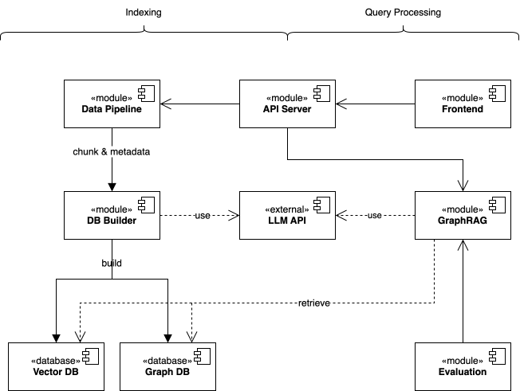

<div align="center">


**지식그래프가 제공하는 풍부한 컨텍스트를 통해 논문을 더 깊이 이해하도록 돕는 AI 논문 분석 서비스**

[](https://python.org)
[](https://fastapi.tiangolo.com)
[](https://github.com/langchain-ai/langchain)
[](https://react.dev)
[](https://vite.dev)
[](https://qdrant.tech)
[](https://neo4j.com)
[](https://docker.com)
[](LICENSE)

🔬[LinkMind LAB research blog](https://linkmind.tistory.com/)


</div>

### 📖 Introduction

논문을 이해하는 것은 하나의 문서를 읽는 것으로 끝나지 않습니다. 연구자는 선행 연구를 확인하고, 관련 연구를 비교하며, 후속 연구를 탐색하는 과정을 통해 비로소 연구의 전체 맥락을 이해합니다.

기존 AI 논문 리딩 서비스인 **Moonlight**는 논문의 내용을 쉽게 이해하도록 돕지만, 개별 논문에 초점을 맞추고 있어 해당 논문을 깊이 이해하는 데 필요한 관련 연구의 배경지식과 연구 맥락을 함께 제공하기에는 한계가 있습니다.

특히 연구자가 궁금해하는 질문은 의미적으로 유사한 논문을 검색하는 것만으로 해결되지 않는 경우가 많습니다. *"이 논문은 기존 연구와 무엇이 다른가?"*, *"이 논문의 한계를 해결한 후속 연구는 무엇인가?"*, *"이 연구는 어떤 연구 흐름 속에서 등장했는가?"*와 같은 질문에 답하려면 개별 논문의 내용뿐 아니라 **논문 간의 인용 관계와 연구 흐름을 함께 이해**해야 합니다. 즉, **논문 간 관계를 연결하여 하나의 문맥으로 탐색할 수 있는 구조**가 필요합니다.

**LinkPaper**는 이러한 문제를 해결하기 위해 논문을 깊이 이해하는 데 필요한 관련 연구의 배경지식까지 함께 탐색할 수 있는 환경을 제공합니다. 이를 위해 논문, 저자, 키워드, 인용 관계를 **지식그래프**로 구축하고, **GraphRAG**를 활용하여 그래프 탐색과 의미 기반 검색을 통해 논문에 대한 입체적인 이해를 제공합니다.

궁극적으로 LinkPaper는 단순한 논문 챗봇을 넘어, 논문 간의 연결 관계를 바탕으로 연구의 맥락 속에서 논문을 이해하도록 돕는 서비스를 지향합니다.

---

### ✨ Key Features

#### 💬 Paper Q&A
선택한 논문의 내용을 기반으로 질의응답을 제공하여 논문의 복잡한 개념과 세부 내용을 이해할 수 있습니다.

#### 🌐 GraphRAG-based Research Q&A
관련 논문과 인용 관계가 저장된 지식그래프 기반 GraphRAG를 활용하여, 현재 논문을 더 깊이 이해할 수 있는 심층 질의응답을 제공합니다.

#### 🧭 Research Flow Exploration
선행 연구, 후속 연구, 관련 논문의 연결 관계를 탐색하며 하나의 논문이 연구 분야에서 어떤 위치와 의미를 가지는지 이해할 수 있습니다.
> 💡 **예시 질문**
> - 이 논문에 소개된 ~라는 개념을 다른 논문에선 어떻게 설명하고 있지?
> - 이 논문의 한계를 해결한 후속 연구는 무엇인가?
> - 이 연구는 어떤 연구 흐름 속에서 등장했는가?

---

### 🎬 Demo

> 🚧 Coming Soon

#### Demo Contents

- 🔍 Hugging Face Papers에 등록된 논문 검색
- 📄 논문 기반 AI 챗봇
- 🌐 GraphRAG가 제공하는 컨텍스트 기반 심층 질의응답

---

### 🏗️ Architecture

#### Component Diagram

<div align="center">
  
</div>

실행 계층은 두 개로 분리한다. `indexing/`은 스케줄에 따라 데이터를
전처리하고 Neo4j·Qdrant에 적재하는 오프라인 엔진이며, `backend/`는 완성된
인덱스를 읽어 사용자 검색과 GraphRAG 요청을 처리하는 온라인 API다.

---

### 📂 Project Structure

```text
linkpaper/
├── backend/          # 사용자 요청을 처리하는 온라인 FastAPI 서버
├── indexing/         # 주기 실행 전처리·Neo4j/Qdrant 적재 엔진
├── evaluation/       # 검색·추출·생성 평가 하네스
├── frontend/         # 사용자 웹 애플리케이션
├── docs/             # 요구사항, 데이터·검색 아키텍처와 스키마
├── scripts/          # 개발·운영 보조 스크립트
├── docker-compose.yml
└── README.md
```

---

### 🚀 Usage

#### 현재 제공 기능

- Hugging Face Papers 논문 검색과 최신 Daily Papers 목록
- 선택한 논문 한 편을 근거로 답하는 스트리밍 채팅

GraphRAG 기반 답변과 연구 흐름 탐색은 아직 채팅에 연결되어 있지 않습니다. 진행 상황은
[`docs/pipeline-development.md`](docs/pipeline-development.md)를 참고하세요.

#### 요구 사항

| 항목 | 버전 | 사용처 |
|---|---|---|
| OpenAI API 키 | - | 채팅의 임베딩과 답변 생성 (필수) |
| Docker Engine / Compose V2 | 20.10+ | Docker 실행, 메모리 8GB 이상 권장 |
| Python | 3.11+ | 로컬 백엔드 실행 |
| Node.js | 18+ (24에서 확인) | 로컬 프론트엔드 실행 |
| pnpm | 11 (11.15에서 확인) | 프론트엔드 패키지 관리 |

#### 필요 라이브러리

패키지는 아래 파일에 정의되어 있으며, 실행 절차를 따르면 자동으로 설치됩니다.

| 영역 | 정의 파일 | 주요 라이브러리 |
|---|---|---|
| Backend | `backend/pyproject.toml` | FastAPI, Uvicorn, HTTPX, OpenAI SDK, Pydantic Settings, Neo4j, Qdrant Client |
| Frontend | `frontend/package.json` | React 18, Vite 5, Zustand, React Markdown, remark-gfm, Lucide React |
| Indexing | `indexing/pyproject.toml` | PyMuPDF4LLM, LangChain Text Splitters, Neo4j, Qdrant Client |
| Evaluation | `evaluation/pyproject.toml` | 평가 하네스 전용 의존성 |

#### 환경 변수 준비

```bash
git clone https://github.com/linkmind-ai/linkpaper.git
cd linkpaper
cp .env.example .env
```

`.env`의 `OPENAI_API_KEY`에 실제 키를 넣습니다. 키가 비어 있어도 논문 검색은 되지만
채팅은 오류를 반환합니다. `.env`는 Git에 커밋되지 않습니다.

#### 방법 1. Docker로 전체 실행

Frontend, Backend, Neo4j, Qdrant, PostgreSQL을 함께 실행합니다.

```bash
docker compose up -d --build
```

| 서비스 | 주소 |
|---|---|
| 웹 애플리케이션 | http://localhost:5173 |
| API 문서 (Swagger) | http://localhost:8000/docs |
| Neo4j Browser | http://localhost:7474 |

종료는 `docker compose down`으로 합니다.

#### 방법 2. 로컬에서 개발 실행

현재 채팅은 Neo4j와 Qdrant를 사용하지 않으므로 Backend와 Frontend만 실행해도 됩니다.
터미널 두 개를 사용합니다.

**터미널 1: Backend** (macOS / Linux)

```bash
cd backend
cp ../.env .env
python3 -m venv .venv
source .venv/bin/activate
pip install ".[dev]"
uvicorn linkpaper.main:app --reload --app-dir src
```

**터미널 1: Backend** (Windows PowerShell)

```powershell
cd backend
Copy-Item ..\.env .env
python -m venv .venv
.venv\Scripts\Activate.ps1
pip install ".[dev]"
uvicorn linkpaper.main:app --reload --app-dir src
```

**터미널 2: Frontend**

```bash
cd frontend
pnpm install
pnpm dev
```

브라우저에서 http://localhost:5173 을 엽니다. Backend를 8000번이 아닌 포트에서 실행했다면
Frontend를 시작하기 전에 `VITE_BACKEND_ORIGIN`을 해당 주소로 지정합니다.

> **Windows 주의**: 프로젝트 경로에 한글이 있으면 `pip install -e`를 쓰지 마세요. 설치된
> `.pth` 파일 때문에 해당 환경의 Python이 시작되지 않습니다. 위 절차는 일반 설치 후
> `--app-dir src`로 소스 코드를 불러오므로 코드 수정도 바로 반영됩니다.

#### 연결 구조

```text
브라우저 → Vite 개발 서버 (:5173) → /api 프록시 → FastAPI (:8000)
```

| 기능 | API | 비고 |
|---|---|---|
| 논문 검색 | `GET /api/v1/papers/search?q=검색어` | `q`가 없으면 최신 Daily Papers 반환 |
| 채팅 | `POST /api/v1/chat/stream` | SSE 스트리밍 응답 |
| 상태 확인 | `GET /api/v1/health` | |

새로운 논문에 대한 첫 질문은 본문을 내려받아 임베딩하므로 시간이 더 걸립니다. 백엔드
서버가 메모리에 논문 한 편의 인덱스만 유지하기 때문에, 다른 논문을 선택하면 다시
인덱싱합니다.

#### 프론트엔드 설정

기본값으로 실제 Backend에 연결됩니다. 값을 바꿀 때만 `frontend/.env`를 만듭니다.

| 변수 | 기본값 | 설명 |
|---|---|---|
| `VITE_USE_MOCK` | `false` | `true`면 Backend 없이 목업 데이터로 UI 확인 |
| `VITE_API_BASE` | `/api/v1` | 브라우저가 호출할 API 경로 |
| `VITE_BACKEND_ORIGIN` | `http://localhost:8000` | 개발 서버 프록시 대상. 셸 환경 변수로 지정 |

#### 논문 인덱스 구축 (선택)

Neo4j와 Qdrant에 데이터를 적재합니다. 현재 채팅에는 필요하지 않습니다.

```bash
docker compose run --rm indexing paper 1706.03762
```

자세한 내용은 [`indexing/README.md`](indexing/README.md)를 참고하세요.

#### 테스트

```bash
cd backend
pytest --ignore=tests/test_retrieval.py
```

`tests/test_retrieval.py`는 아직 구현되지 않은 API를 참조해 수집 단계에서 실패하므로
제외합니다.

#### 문제 해결

| 증상 | 확인할 내용 |
|---|---|
| 논문 목록이 비어 있고 검색 실패 토스트가 표시됨 | Backend 실행 여부, Hugging Face 접속 가능 여부 |
| 채팅에 "답변을 생성하지 못했습니다." 표시 | `backend/.env`의 `OPENAI_API_KEY`, 모델 이름, Backend 로그. 키를 바꾼 뒤에는 Backend를 재시작 |
| 목업 데이터가 표시됨 | `frontend/.env`의 `VITE_USE_MOCK` 값 |

---

### 👥 Team

| 이름 | 역할 | 담당 업무 |
|------|------|-----------|
| 정상헌 | PM / Data | 프로젝트 관리, 요구사항 정의, 데이터 수집 및 전처리 |
| 김대건 | Backend / GraphRAG | GraphRAG 파이프라인 및 FastAPI 개발 |
| 김수용 | Evaluation | GraphRAG 평가 및 벤치마크 구축 |
| 남두현 | Graph DB | 지식 그래프 구축 및 벡터 인덱싱 |
| 오창원 | Frontend | 프론트엔드 개발 및 백엔드 연동 |
| 홍예린 | Infrastructure | Docker, 모델 서빙 및 인프라 운영 |

---

### 📚 References

#### Papers

- Lewis et al., *Retrieval-Augmented Generation for Knowledge-Intensive NLP Tasks* (2020)
- Microsoft Research, *From Local to Global: A GraphRAG Approach to Query-Focused Summarization* (2024)

#### Related Services

- [Moonlight](https://www.themoonlight.io/ko) — AI 기반 논문 요약 및 리딩 서비스
- [AlphaXIV-Open](https://github.com/AsyncFuncAI/alphaxiv-open) — arXiv 논문에 대한 AI 질의응답을 GraphRAG 기반으로 제공하는 오픈소스

---

### 🤝 Contributing

Issue와 Pull Request는 언제든지 환영합니다.

기능 추가나 큰 변경 사항은 먼저 Issue를 통해 논의한 후 진행해 주세요.
